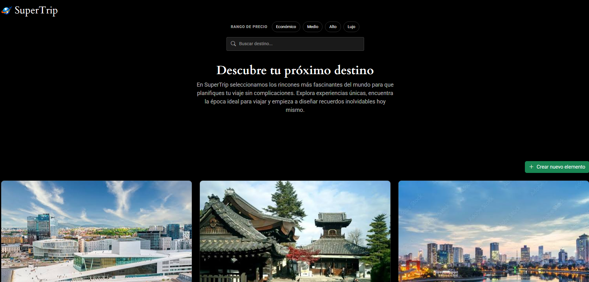
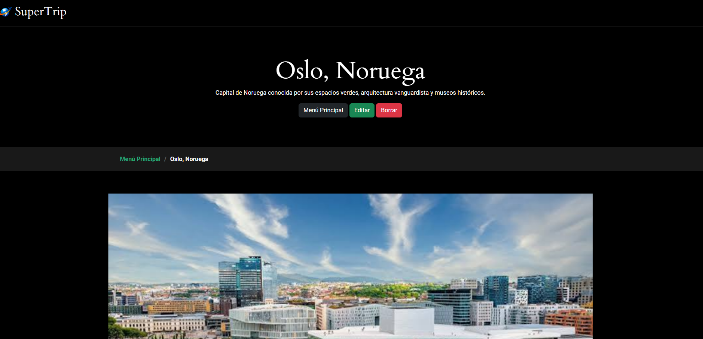
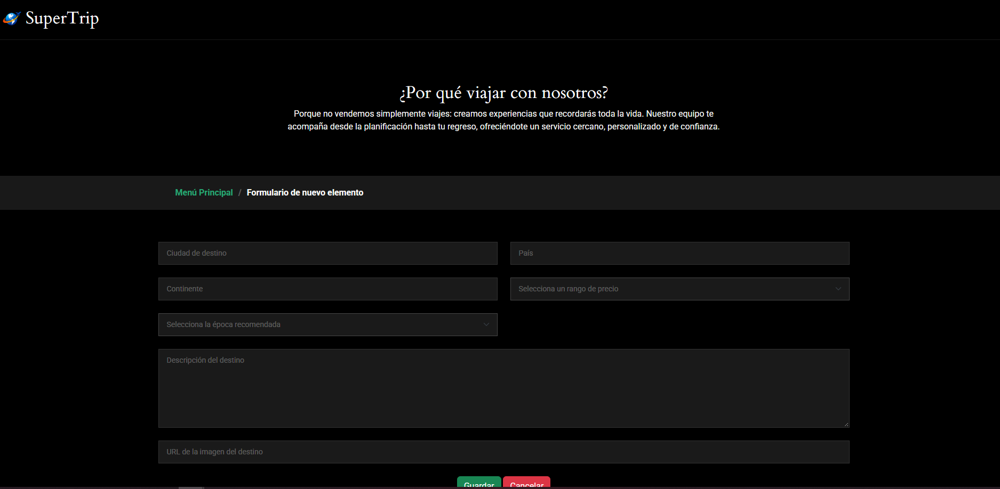

# SuperTrip - Guía de Destinos y Experiencias

## Integrantes del equipo de desarrollo
* **Adrián Varea Fernández** - a.varea.2023@alumnos.urjc.es - GitHub: [blodresg](https://github.com/blodresg)
* **Salvador Barquilla Cedillo** - s.barquilla.2025@alumnos.urjc.es - GitHub: [SalvaB14](https://github.com/SalvaB14)
* **Sergio Abueitah Cantero** - s.abueitah.2025@alumnos.urjc.es - GitHub: [SergioAbueitah](https://github.com/SergioAbueitah)

## Funcionalidad

### Entidades (Relación Conjunto - Partes)

* **Entidad Principal: `Destino`**
  * Representa los lugares o ciudades turísticas almacenadas en la base de datos de la plataforma.
  * **Atributos:**
    * `id`: Identificador único del destino.
    * `nombre`: Nombre de la ciudad o región.
    * `pais`: País al que pertenece.
    * `continente`: Continente o zona geográfica (Europa, Asia, América, África, Oceanía).
    * `descripcion`: Información turística general del destino.
    * `rango_precio`: Clasificación del coste medio del viaje (Económico, Medio, Alto, Lujo).
    * `mejor_epoca`: Época recomendada para la visita (Primavera, Verano, Otoño, Invierno).

* **Entidad Secundaria: `Actividad`**
  * Representa las experiencias, excursiones o puntos de interés específicos que se pueden realizar dentro de un destino.
  * **Atributos:**
    * `id`: Identificador único de la actividad.
    * `titulo`: Nombre de la experiencia.
    * `descripcion`: Detalle de la actividad o excursión.
    * `precio`: Precio individual en euros (€).
    * `categoria_actividad`: Tipo de experiencia (Aventura, Cultura, Gastronomía, Naturaleza).
    * `requiere_reserva`: Indicador de si se requiere reserva previa.

### Imágenes
* **Entidad Principal (`Destino`):** Cada entidad principal tendrá su imagen asociada.
* **Entidad Secundaria (`Actividad`):** Cada entidad secundaria tiene su propia imagen.

### Buscador, filtrado o categorización
* **Buscador:** Cuadro de texto libre que permite consultar aquellos destinos en los que el término introducido esté incluido en el atributo `nombre`.
* **Filtrado:** Permite filtrar el catálogo de destinos por los siguientes parámetros:
  * **País:** Filtra los destinos pertenecientes a un país concreto.
  * **Rango de precio:** Filtro por clasificación de coste (`Económico`, `Medio`, `Alto`, `Lujo`).
  * **Época recomendada:** Selección según la temporada ideal de viaje (`Primavera`, `Verano`, `Otoño`, `Invierno`).
* **Categorización:** Menú de navegación principal/lateral que organiza y muestra los destinos clasificados por su `continente` o zona geográfica (`Europa`, `Asia`, `América`, `África`, `Oceanía`).
* **Filtrado:** Formulario dinámico para filtrar el catálogo de destinos por su `rango_precio` (o presupuesto máximo) y según el tipo de experiencia disponible.
* **Categorización:** Menú de navegación agrupado por `continente` o zona geográfica para navegar por los diferentes destinos.

# Práctica 1

## Capturas de Pantalla

### Página Principal

### Página de Detalle

### Página de Nuevo Elemento

---

## Participación de Miembros del Equipo

---

### 👤 Adrián Varea Fernández (`@blodresg`)

#### Descripción de Tareas Realizadas
* Me he encargado de buscar los datos de ejemplo y sus imágenes, de rellenar la página principal colocando sus elementos y sus botones y de algún arreglo o detalle ocasional del resto de la página.
#### 5 Commits Más Significativos
1. [Página principal](https://github.com/CodeURJC-FW-2026-27/webapp03/commit/bdd1b2de160ec25d71985359ff4daf67edbc60a8)
2. [Cambios a index.html](https://github.com/CodeURJC-FW-2026-27/webapp03/commit/3f8333214e6e8ca33b60ca8e048cac7934d1ca87)
3. [Imágenes destinos](https://github.com/CodeURJC-FW-2026-27/webapp03/commit/aa513510ebfdf0eb347e6e4d43e6d414dc33853a)
4. [Json con datos de ejemplo](https://github.com/CodeURJC-FW-2026-27/webapp03/commit/2e66e987fdbb287d4782dc3c80bb186144d77fe9)
5. [Ajustes de archivos y correcciones](https://github.com/CodeURJC-FW-2026-27/webapp03/commit/d47938503b3d96e062e586567d2f44218f0ebd30)

#### 5 Ficheros Principales
1. [`index.html`](https://github.com/CodeURJC-FW-2026-27/webapp03/blob/main/PhotoFolio/PhotoFolio/index.html)
2. [`detail_page.html`](https://github.com/CodeURJC-FW-2026-27/webapp03/blob/main/PhotoFolio/PhotoFolio/detail_page.html)
3. [`new_element.html`](https://github.com/CodeURJC-FW-2026-27/webapp03/blob/main/PhotoFolio/PhotoFolio/new_element.html)
4. [`assets/css/main.css`](https://github.com/CodeURJC-FW-2026-27/webapp03/blob/main/PhotoFolio/PhotoFolio/assets/css/main.css)
5. [`data.json`](https://github.com/CodeURJC-FW-2026-27/webapp03/blob/main/PhotoFolio/PhotoFolio/data.json)

---

### 👤 Salvador Barquilla Cedillo (`@SalvaB14`)

#### Descripción de Tareas Realizadas
* He diseñado la página de nuevo elemento y el formulario de nueva actividad de la página de detalle. Además de algún que otro arreglo mínimo como buscar la plantilla Boostrap.

#### 5 Commits Más Significativos
1. [Formuario de nuevo elemento (aún sin detallar por completo)](https://github.com/CodeURJC-FW-2026-27/webapp03/commit/1f1db62c1999a134012ddb9a822d4e3d05d92d04)
2. [Formulario de nueva actividad (aún sin detallar por completo)](https://github.com/CodeURJC-FW-2026-27/webapp03/commit/11a62fd37ed24a3c8bcd37cc4ad1b2e204ed4006)
3. [Elección de algunos elementos mediante desplegables](https://github.com/CodeURJC-FW-2026-27/webapp03/commit/e6e54499bfec819a2be097dda6268096285e4e21)
4. [Cambio final en diseño de formularios](https://github.com/CodeURJC-FW-2026-27/webapp03/commit/6cbae8bcd47d254b9dff0a81f6b6b27c27d0b88c)
5. [Cambio de diseño en los botones](https://github.com/CodeURJC-FW-2026-27/webapp03/commit/158cc52353143c8a6cb360519557b919f2ba2b1e)

#### 5 Ficheros Principales
1. [`new_element.html`](https://github.com/CodeURJC-FW-2026-27/webapp03/blob/main/PhotoFolio/PhotoFolio/new_element.html)
2. [`detail_page.html`](https://github.com/CodeURJC-FW-2026-27/webapp03/blob/main/PhotoFolio/PhotoFolio/detail_page.html)
3. [`index.html`](https://github.com/CodeURJC-FW-2026-27/webapp03/blob/main/PhotoFolio/PhotoFolio/index.html)
4. [`assets/css/main.css`](https://github.com/CodeURJC-FW-2026-27/webapp03/blob/main/PhotoFolio/PhotoFolio/assets/css/main.css)
5. [`assets/img`](https://github.com/CodeURJC-FW-2026-27/webapp03/blob/main/PhotoFolio/PhotoFolio/assets/img)

---

### 👤 Sergio Abueitah Cantero (`@SergioAbueitah`)

#### Descripción de Tareas Realizadas
* Diseño y maquetación responsiva del menú de navegación y pie de página.
* Estilado de componentes para la visualización de detalles de actividades en cada destino.
* Ajustes de accesibilidad y adaptación del diseño general a diferentes resoluciones de pantalla.

#### 5 Commits Más Significativos
1. [style: add header and responsive navigation bar](https://github.com/USUARIO/REPO/commit/HASH_COMMIT_1)
2. [feat: design activity detail view layout](https://github.com/USUARIO/REPO/commit/HASH_COMMIT_2)
3. [style: apply consistent footer layout across pages](https://github.com/USUARIO/REPO/commit/HASH_COMMIT_3)
4. [fix: media query adjustments for mobile screens](https://github.com/USUARIO/REPO/commit/HASH_COMMIT_4)
5. [style: integrate activity card component styles](https://github.com/USUARIO/REPO/commit/HASH_COMMIT_5)

#### 5 Ficheros Principales
1. [`public/css/navbar.css`](https://github.com/USUARIO/REPO/blob/main/public/css/navbar.css)
2. [`views/activity-detail.html`](https://github.com/USUARIO/REPO/blob/main/views/activity-detail.html)
3. [`public/css/footer.css`](https://github.com/USUARIO/REPO/blob/main/public/css/footer.css)
4. [`src/data/activities.json`](https://github.com/USUARIO/REPO/blob/main/src/data/activities.json)
5. [`public/js/activities.js`](https://github.com/USUARIO/REPO/blob/main/public/js/activities.js)
