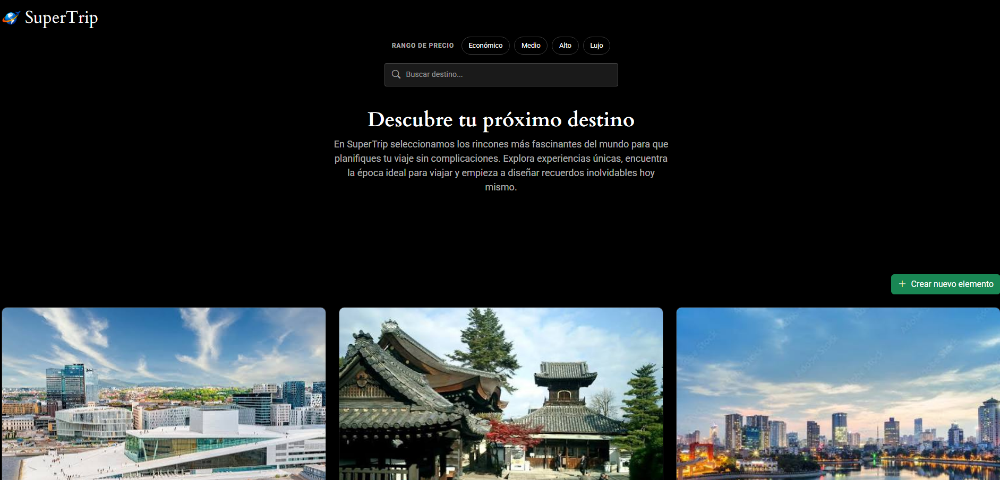
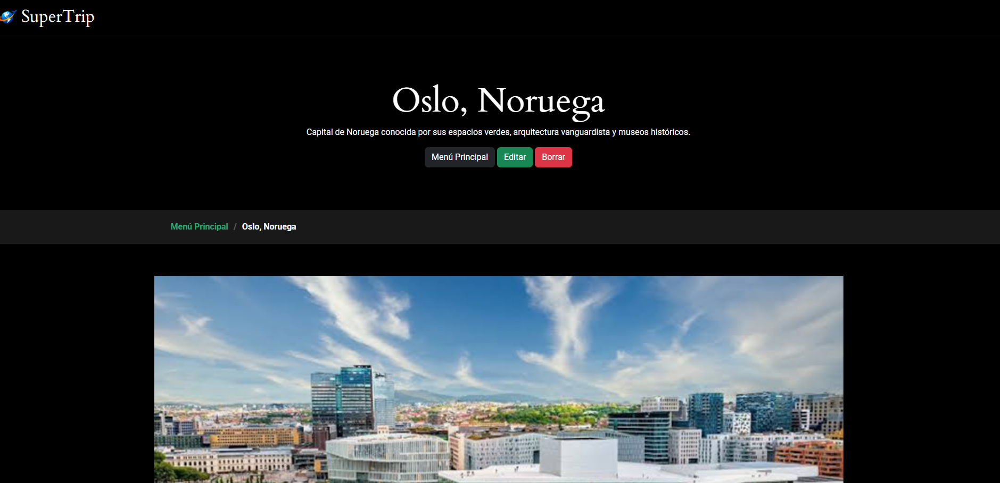
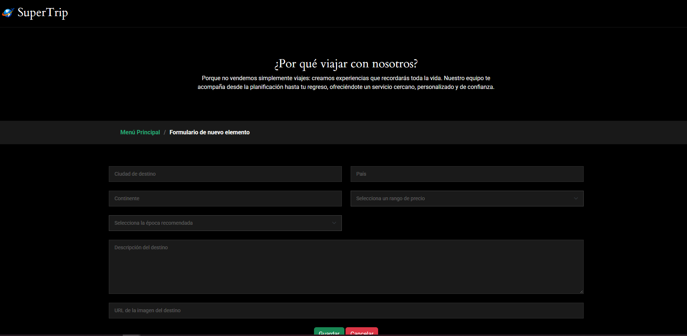

# SuperTrip - Guía de Destinos y Experiencias

## Integrantes del equipo de desarrollo
* **Adrián Varea Fernández** - a.varea.2023@alumnos.urjc.es - GitHub: [blodresg](https://github.com/blodresg)
* **Salvador Barquilla Cedillo** - s.barquilla.2025@alumnos.urjc.es - GitHub: [SalvaB14](https://github.com/SalvaB14)
* **Sergio Abueitah Cantero** - s.abueitah.2025@alumnos.urjc.es - GitHub: [SergioAbueitah](https://github.com/SergioAbueitah)

## Funcionalidad

### Entidades (Relación Conjunto - Partes)

* **Entidad Principal: `Destino`**
  * Representa los lugares o ciudades turísticas almacenadas en la base de datos de la plataforma.
  * **Atributos:**
    * `id`: Identificador único del destino.
    * `nombre`: Nombre de la ciudad o región.
    * `pais`: País al que pertenece.
    * `continente`: Continente o zona geográfica (Europa, Asia, América, África, Oceanía).
    * `descripcion`: Información turística general del destino.
    * `rango_precio`: Clasificación del coste medio del viaje (Económico, Medio, Alto, Lujo).
    * `mejor_epoca`: Época recomendada para la visita (Primavera, Verano, Otoño, Invierno).

* **Entidad Secundaria: `Actividad`**
  * Representa las experiencias, excursiones o puntos de interés específicos que se pueden realizar dentro de un destino.
  * **Atributos:**
    * `id`: Identificador único de la actividad.
    * `titulo`: Nombre de la experiencia.
    * `descripcion`: Detalle de la actividad o excursión.
    * `precio`: Precio individual en euros (€).
    * `categoria_actividad`: Tipo de experiencia (Aventura, Cultura, Gastronomía, Naturaleza).
    * `requiere_reserva`: Indicador de si se requiere reserva previa.

### Imágenes
* **Entidad Principal (`Destino`):** Cada entidad principal tendrá su imagen asociada.
* **Entidad Secundaria (`Actividad`):** Cada entidad secundaria tiene su propia imagen.

### Buscador, filtrado o categorización
* **Buscador:** Cuadro de texto libre que permite consultar aquellos destinos en los que el término introducido esté incluido en el atributo `nombre`.
* **Filtrado:** Permite filtrar el catálogo de destinos por los siguientes parámetros:
  * **País:** Filtra los destinos pertenecientes a un país concreto.
  * **Rango de precio:** Filtro por clasificación de coste (`Económico`, `Medio`, `Alto`, `Lujo`).
  * **Época recomendada:** Selección según la temporada ideal de viaje (`Primavera`, `Verano`, `Otoño`, `Invierno`).
* **Categorización:** Menú de navegación principal/lateral que organiza y muestra los destinos clasificados por su `continente` o zona geográfica (`Europa`, `Asia`, `América`, `África`, `Oceanía`).
* **Filtrado:** Formulario dinámico para filtrar el catálogo de destinos por su `rango_precio` (o presupuesto máximo) y según el tipo de experiencia disponible.
* **Categorización:** Menú de navegación agrupado por `continente` o zona geográfica para navegar por los diferentes destinos.

# Práctica 1

## Capturas de Pantalla

### Página Principal
[](PhotoFolio/PhotoFolio/assets/img/captura_index.jpg)

### Página de Detalle
[](PhotoFolio/PhotoFolio/assets/img/captura_detalle.jpg)

### Página de Nuevo Elemento
[](PhotoFolio/PhotoFolio/assets/img/captura_formulario-jpg.png)

---

## Participación de Miembros del Equipo

---

### 👤 Adrián Varea Fernández (`@blodresg`)

#### Descripción de Tareas Realizadas
* Me he encargado de buscar los datos de ejemplo y sus imágenes, de rellenar la página principal colocando sus elementos y sus botones y de algún arreglo o detalle ocasional del resto de la página.
#### 5 Commits Más Significativos
1. [Página principal](https://github.com/CodeURJC-FW-2026-27/webapp03/commit/bdd1b2de160ec25d71985359ff4daf67edbc60a8)
2. [Cambios a index.html](https://github.com/CodeURJC-FW-2026-27/webapp03/commit/3f8333214e6e8ca33b60ca8e048cac7934d1ca87)
3. [Imágenes destinos](https://github.com/CodeURJC-FW-2026-27/webapp03/commit/aa513510ebfdf0eb347e6e4d43e6d414dc33853a)
4. [Json con datos de ejemplo](https://github.com/CodeURJC-FW-2026-27/webapp03/commit/2e66e987fdbb287d4782dc3c80bb186144d77fe9)
5. [Ajustes de archivos y correcciones](https://github.com/CodeURJC-FW-2026-27/webapp03/commit/d47938503b3d96e062e586567d2f44218f0ebd30)

#### 5 Ficheros Principales
1. [`index.html`](https://github.com/CodeURJC-FW-2026-27/webapp03/blob/main/PhotoFolio/PhotoFolio/index.html)
2. [`detail_page.html`](https://github.com/CodeURJC-FW-2026-27/webapp03/blob/main/PhotoFolio/PhotoFolio/detail_page.html)
3. [`new_element.html`](https://github.com/CodeURJC-FW-2026-27/webapp03/blob/main/PhotoFolio/PhotoFolio/new_element.html)
4. [`assets/css/main.css`](https://github.com/CodeURJC-FW-2026-27/webapp03/blob/main/PhotoFolio/PhotoFolio/assets/css/main.css)
5. [`data.json`](https://github.com/CodeURJC-FW-2026-27/webapp03/blob/main/PhotoFolio/PhotoFolio/data.json)

---

### 👤 Salvador Barquilla Cedillo (`@SalvaB14`)

#### Descripción de Tareas Realizadas
* He diseñado la página de nuevo elemento y el formulario de nueva actividad de la página de detalle. Además de algún que otro arreglo mínimo como buscar la plantilla Bootstrap.

#### 5 Commits Más Significativos
1. [Formuario de nuevo elemento (aún sin detallar por completo)](https://github.com/CodeURJC-FW-2026-27/webapp03/commit/1f1db62c1999a134012ddb9a822d4e3d05d92d04)
2. [Formulario de nueva actividad (aún sin detallar por completo)](https://github.com/CodeURJC-FW-2026-27/webapp03/commit/11a62fd37ed24a3c8bcd37cc4ad1b2e204ed4006)
3. [Elección de algunos elementos mediante desplegables](https://github.com/CodeURJC-FW-2026-27/webapp03/commit/e6e54499bfec819a2be097dda6268096285e4e21)
4. [Cambio final en diseño de formularios](https://github.com/CodeURJC-FW-2026-27/webapp03/commit/6cbae8bcd47d254b9dff0a81f6b6b27c27d0b88c)
5. [Cambio de diseño en los botones](https://github.com/CodeURJC-FW-2026-27/webapp03/commit/158cc52353143c8a6cb360519557b919f2ba2b1e)


#### 5 Ficheros Principales
1. [`new_element.html`](https://github.com/CodeURJC-FW-2026-27/webapp03/blob/main/PhotoFolio/PhotoFolio/new_element.html)
2. [`detail_page.html`](https://github.com/CodeURJC-FW-2026-27/webapp03/blob/main/PhotoFolio/PhotoFolio/detail_page.html)
3. [`index.html`](https://github.com/CodeURJC-FW-2026-27/webapp03/blob/main/PhotoFolio/PhotoFolio/index.html)
4. [`assets/css/main.css`](https://github.com/CodeURJC-FW-2026-27/webapp03/blob/main/PhotoFolio/PhotoFolio/assets/css/main.css)
5. [`assets/img`](https://github.com/CodeURJC-FW-2026-27/webapp03/blob/main/PhotoFolio/PhotoFolio/assets/img)

---

### 👤 Sergio Abueitah Cantero (`@SergioAbueitah`)

#### Descripción de Tareas Realizadas
* Me he encargado de realizar la pagina de detalle, de buscar las imágenes de la entidad principal y de las entidades secundarias, y de colocar toda la información y los respectivos botones de cada actividad 

#### 5 Commits Más Significativos
1. [Informacion destino](https://github.com/CodeURJC-FW-2026-27/webapp03/commit/5e5080fc9c45c3bf4e61c8148dba36b83a5adf20)
2. [Imágenes y enlaces](https://github.com/CodeURJC-FW-2026-27/webapp03/commit/d8187bbfa87f01cb63c07fb069417a6e9bb665ac)
3. [Completando informacion del destino](https://github.com/CodeURJC-FW-2026-27/webapp03/commit/1aacacce822e41ca8ae53d22d15e44306b3b2e26)
4. [Estilo y color de los botones](https://github.com/CodeURJC-FW-2026-27/webapp03/commit/0449d3ffe7825919583063f5542afcf7e7042fd8)
5. [Cambio final en el color de los botones](https://github.com/CodeURJC-FW-2026-27/webapp03/commit/70e54cc34b77625bf99d94fa4da327899a14c431)

#### 5 Ficheros Principales
1. [`detail_page.html`](https://github.com/CodeURJC-FW-2026-27/webapp03/blob/main/PhotoFolio/PhotoFolio/detail_page.html)
2. [`index.html`](https://github.com/CodeURJC-FW-2026-27/webapp03/blob/main/PhotoFolio/PhotoFolio/index.html)
3. [`new_element.html`](https://github.com/CodeURJC-FW-2026-27/webapp03/blob/main/PhotoFolio/PhotoFolio/new_element.html)
4. [`assets/css/main.css`](https://github.com/CodeURJC-FW-2026-27/webapp03/blob/main/PhotoFolio/PhotoFolio/assets/css/main.css)
5. [`data.json`](https://github.com/CodeURJC-FW-2026-27/webapp03/blob/main/PhotoFolio/PhotoFolio/data.json)


# Práctica 2

## Instrucciones de ejecución

### Requisitos
* Node.js 20 o superior.
* MongoDB Server 6 o superior, ejecutándose en `localhost:27017`.
* MongoDB Compass es recomendable, pero opcional: permite conectarse al servidor y explorar la base de datos mediante una interfaz gráfica.

### Instalación y ejecución
Clonar el repositorio, instalar las dependencias y arrancar la aplicación:

```bash
git clone https://github.com/CodeURJC-FW-2026-27/webapp03.git
cd webapp03
npm install
npm start
```

No hay un paso de compilación adicional. La aplicación estará disponible en [http://localhost:3000](http://localhost:3000). Al arrancar, se cargan los datos de ejemplo si la base de datos está vacía y se copian las imágenes de `data/images` a `uploads`.

## Descripción de ficheros

* `src/app.js`: configura Express, las vistas y los recursos estáticos.
* `src/router.js`: define las rutas, procesa formularios y valida los datos.
* `src/travel.js`: operaciones de lectura y escritura de destinos y actividades en MongoDB.
* `src/load_data.js`: carga los datos de ejemplo y copia las imágenes al arrancar.
* `views/index.html`: listado y búsqueda de destinos.
* `views/detail_page.html`: detalle del destino y sus actividades.
* `views/new_element.html`: formulario para crear y editar destinos.
* `views/edit_activity.html` y `views/partials/activity_form.html`: edición y formulario de actividades.
* `views/notice.html`: avisos de éxito y errores.
* `views/partials/site_header.html` y `views/partials/site_footer.html`: cabecera y pie compartidos.
* `data/data.json` y `data/images/`: datos e imágenes de ejemplo.
* `public/`: hojas de estilo, JavaScript y recursos estáticos.

## Vídeo demostrativo

* **YouTube (mínimo 1 minuto):** (https://github.com/CodeURJC-FW-2026-27/webapp03)

## Participación de miembros


### 👤 Adrián Varea Fernández (`@blodresg`)

**Tareas realizadas:** 
Me he ocupado de la configuración inicial del proyecto, copiando el código de ejemplo y modificándolo. He desarrollado la creación de nuevo elemento, las páginas de error y éxito (que luego también adaptan mis compañeros) y me he encargado de los retoques finales a la web.

**5 commits más significativos**
1. [Configuración inicial](https://github.com/CodeURJC-FW-2026-27/webapp03/commit/40960f132f2708754a9956b14363ee5a842393c2)
2. [Crear elemento, header, footer y más cambios](https://github.com/CodeURJC-FW-2026-27/webapp03/commit/8664e3dd258a94ecbb62b2a03f4d7eb160feaf5d)
3. [Arreglos finales](https://github.com/CodeURJC-FW-2026-27/webapp03/commit/1186bd85770af48e20f63ed1f1c959a3130acfa4)
4. [Arreglo de imágenes](https://github.com/CodeURJC-FW-2026-27/webapp03/commit/7132adfd7aced8ee9ac81bbab211ace69f758881)
5. [Arreglo a idioma de valores de formulario](https://github.com/CodeURJC-FW-2026-27/webapp03/commit/cc434fcb9dcb0fe11fc1ee45e213c267deae4826)

**5 ficheros principales**
1. [router.js](https://github.com/CodeURJC-FW-2026-27/webapp03/blob/main/src/router.js)
2. [travel.js](https://github.com/CodeURJC-FW-2026-27/webapp03/blob/main/src/travel.js)
3. [notice.html](https://github.com/CodeURJC-FW-2026-27/webapp03/blob/main/views/notice.html)
4. [detail_page.html](https://github.com/CodeURJC-FW-2026-27/webapp03/blob/main/views/detail_page.html)
5. [new.element.html](https://github.com/CodeURJC-FW-2026-27/webapp03/blob/main/views/new_element.html)

### 👤 Salvador Barquilla Cedillo (`@SalvaB14`)

**Tareas realizadas:** [Completar]

**5 commits más significativos**
1. [Diseño y funcionalidad de la página principal](https://github.com/CodeURJC-FW-2026-27/webapp03/commit/88698c829893b9706cd6787c088ca3bb4a08a14f)
2. [Página de error (no es la misma que la definitiva) y algún ajuste de otras páginas y ficheros](https://github.com/CodeURJC-FW-2026-27/webapp03/commit/754450657d2f4215d91bb2079a6c8ec6eccc98ee)
3. [Cambio de idioma de comentarios](https://github.com/CodeURJC-FW-2026-27/webapp03/commit/fc09bb8835a76717ef466101c0b75455e61eb2a4)

**5 ficheros principales**
1. [`index.html`](https://github.com/CodeURJC-FW-2026-27/webapp03/blob/main/views/index.html)
2. [`router.js`](https://github.com/CodeURJC-FW-2026-27/webapp03/blob/main/src/router.js)
3. [`travel.js`](https://github.com/CodeURJC-FW-2026-27/webapp03/blob/main/src/travel.js)
4. [`main.css`](https://github.com/CodeURJC-FW-2026-27/webapp03/blob/main/public/main.css)
5. [`.gitignore`](https://github.com/CodeURJC-FW-2026-27/webapp03/blob/main/.gitignore)

### 👤 Sergio Abueitah Cantero (`@SergioAbueitah`)

**Tareas realizadas:** [Completar]

**5 commits más significativos**
1. [Descripción del commit](URL_DEL_COMMIT_1)
2. [Descripción del commit](URL_DEL_COMMIT_2)
3. [Descripción del commit](URL_DEL_COMMIT_3)
4. [Descripción del commit](URL_DEL_COMMIT_4)
5. [Descripción del commit](URL_DEL_COMMIT_5)

**5 ficheros principales**
1. [`Fichero 1`](RUTA_DEL_FICHERO_1)
2. [`Fichero 2`](RUTA_DEL_FICHERO_2)
3. [`Fichero 3`](RUTA_DEL_FICHERO_3)
4. [`Fichero 4`](RUTA_DEL_FICHERO_4)
5. [`Fichero 5`](RUTA_DEL_FICHERO_5)
